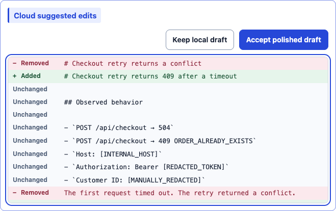

# Handoff

Handoff turns developer logs into editable Markdown bug reports. It previews masked bearer tokens and internal hostnames, uses Chrome's on-device model to draft the issue, and can polish an approved draft with Firebase AI Logic. You can copy the Markdown or save it to reopen later in the same browser profile.

The on-device draft uses only the redaction preview and runs without a cloud fallback. Cloud polishing sends the exact draft shown in the confirmation panel. Saving stores the report title, Markdown, and server-generated update time in Firestore. Review the preview and report before sharing or saving real logs.

## Try Handoff

1. In **Issue report**, click **Try the checkout example**. Handoff fills in the synthetic logs and three reproduction steps. Click **Preview redaction** to see the automatic hostname and bearer-token masks.
2. In the preview, select `demo_customer_8427` and click **Mask all matches**. Check that the original ID is gone from the preview.
3. Once Chrome’s on-device model is downloaded, keep Handoff open, turn off Wi-Fi, and click **Generate draft locally**. For a first download, keep Wi-Fi on while Chrome prepares the model. Check the draft for `504`, `409 ORDER_ALREADY_EXISTS`, all three steps, and the redaction placeholders. If the model is unavailable, choose **Write report manually** to open a blank Markdown template.
4. Reconnect, click **Review for cloud**, and read **What will be sent**. Try **Cancel** first, then reopen the review and choose **Send to cloud** when you’re ready.
5. Inspect the cloud diff and click **Accept polished draft**. Click **Save draft**, reload the page, and reopen the report under **Saved drafts** in the same browser profile.



The screenshot uses synthetic checkout data and a simulated cloud response.

## Run locally

Use Node.js 20.9 or newer and a supported desktop Chrome with its on-device model available. Follow the [Firebase AI Logic desktop Chrome setup guide](https://firebase.google.com/docs/ai-logic/hybrid/web/get-started) if the local model needs to download.

```sh
npm ci
cp .env.example .env.local
```

Complete the Firebase setup below, then run `npm run dev` and open [http://localhost:3000](http://localhost:3000). Use the `localhost` hostname for the cloud demo.

## Firebase setup

1. Create a Firebase project and register a web app. Copy its `apiKey`, `authDomain`, `projectId`, and `appId` into the matching fields in `.env.local`. These values are part of the browser bundle. Use the web app's Firebase API key with Firebase API restrictions. Keep direct Gemini API keys, service-account credentials, and App Check debug tokens private. [Firebase API key guidance](https://firebase.google.com/docs/projects/api-keys)
2. In the Firebase console, set up **Firebase AI Logic** with the **Gemini Developer API** provider and keep App Check enforcement enabled for AI Logic. [Firebase AI Logic setup](https://firebase.google.com/docs/ai-logic/hybrid/web/get-started)
3. Enable **Anonymous** under **Authentication → Sign-in method**. Handoff restores the browser's Firebase session before creating an anonymous account. [Firebase Anonymous Auth](https://firebase.google.com/docs/auth/web/anonymous-auth)
4. Create the default **Cloud Firestore** database. Open its **Rules** tab, paste [firestore.rules](firestore.rules), and click **Publish**. The rules allow the authenticated owner to read, list, create, and update reports under `users/{uid}/drafts/{draftId}`. All other client access is denied. [Publishing Firestore rules](https://firebase.google.com/docs/firestore/security/get-started)
5. On localhost, open Chrome DevTools, expand **Development diagnostics**, and click **Test cloud AI** to generate the browser's App Check debug token during initial setup. Register it for your web app under **App Check → Apps → Manage debug tokens**, then retry. Once registered, cloud polishing works directly from the confirmation panel. [App Check debug provider](https://firebase.google.com/docs/app-check/web/debug-provider)

For hosted cloud polishing, register the web app with the **reCAPTCHA Enterprise** provider in Firebase App Check and add the hosting domain to the score-based key. Set the public site key as `NEXT_PUBLIC_FIREBASE_APPCHECK_SITE_KEY` in the Vercel Production environment, then deploy a new build. [Firebase App Check setup](https://firebase.google.com/docs/app-check/web/recaptcha-enterprise-provider)

## Try other inputs

- Select **CSV import** from **Try an example** and mask `demo.import@example.test`. The report should preserve row 17 and `INVALID_DATE (Expected YYYY-MM-DD)`.
- Choose or drop a UTF-8 `.log` or `.txt` file up to 1 MB to populate the log editor in your browser.
- To compare runs, expand **Add baseline logs**, paste a working run, and preview redaction. Check **Include comparison in local draft** to give the on-device model context around the first changed line.

## Checks

```sh
npm run lint
npx next typegen
npx tsc --noEmit
npm run build
```

If your sandbox blocks Turbopack from binding a local worker port, run `npm run build -- --webpack`.

## License

[MIT](LICENSE)
